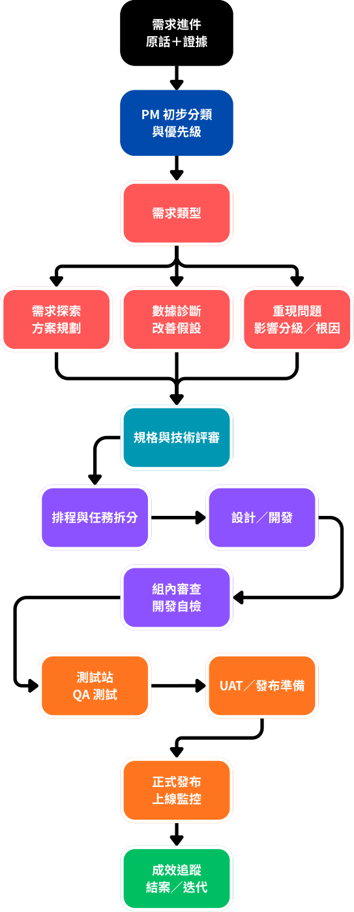

# 核心開發流程規範

所有專案類型共用的核心流程與規則。平台、遊戲、未來新專案類型不重複本文件內容，只在各自的擴充範例裡補上跟核心不同的地方。

## 1. 開發流程圖



所有需求先記錄，再依類型採用合適深度的流程。

### 角色職責

依「1. 開發流程圖」的階段對齊各角色的職責說明。

| 角色 | 職責 |
|---|---|
| PM（含企劃） | PM初步分類：決定問題、優先級、商業範圍與跨單位協調。<br>規格與技術評審：負責需求探索與規格書撰寫；確認範圍與驗收條件，未定案事項指定決策人與期限；不單方面指定技術實作。<br>排程與任務拆分：確認任務符合本次範圍、週期與交付日期。<br>組內審查/開發自檢：協助排除跨組阻塞，不代替組長做技術品質判定。<br>UAT/發布準備：參與驗收；預期延遲時與需求方協調時程、範圍或優先順序，並更新決策。 |
| 技術組長（依專業：美術/前端/後端/QA/SRE） | 規格與技術評審：參與技術訪談，確認方案、拆分工作、指派成員、回報開始與預計送測日。<br>組內審查/開發自檢：審核組內產出品質；預期延遲時主動告知 PM，說明原因、影響與替代方案。 |
| 工程/實作 | 設計/開發：依組長分派執行；規格不清時必須回問，不可自行猜測商業邏輯。 |
| 設計 | 設計/開發：負責體驗解法與畫面狀態設計。 |
| QA | 測試站/QA測試：負責測試策略與品質判定。 |
| 需求方 | 需求進件：提出需求。<br>UAT/發布準備：參與驗收。 |

## 2. 開發階段各角色職掌

```
0 需求登錄/證據 → 1 初步分級 → 2 問題分析 → 3 規格/設計 → 4 需求確認 → 5 技術評審
  → 6 拆分/排程 → 7 開發 → 8 組內審查/自檢 → 9 PM驗證 → 10 測試站/QA
  → 11 驗收/發布準備 → 12 正式發布/監控 → 13 回顧/結案/迭代
```

| 步驟 | 責任人 | 要做什麼/產出什麼 | 可往下走的條件 |
|---|---|---|---|
| 0 | PM | 保留需求原話、提出人、時間、來源、截圖/錄影/紀錄檔/數據 | 第三人可理解誰在何情境提出何事，且證據可追溯 |
| 1 | PM | 記錄任務類型（新增/優化/BUG）、影響嚴重度與處理優先級 | 問題類型與優先級已明確，可進入下一步分析 |
| 2 | PM | 定義使用者、痛點、範圍、成功指標；優化要有基準值，BUG要有重現與替代方案 | 能說清楚問題與成功條件，不只是重述提出者的解法 |
| 3 | PM+設計 | 完成規格書、原型稿與驗收條件 | 規格書版本一致，可交付需求方確認 |
| 4 | PM | PM 以規格書與需求方確認方向與內容是否正確 | 需求方已確認規格內容無誤，可進入技術評審 |
| 5 | 組長/QA | 技術文件審查，記錄方案、風險、估時、相依、未決事項、決策人與期限 | 所有阻塞開發的問題已決定 |
| 6 | PM+技術組長 | 組長拆分子任務並回報開始與預計送測日；PM 設定開發週期、主要負責人、審核人、期限與相依關係 | 符合開發準備完成條件（DoR） |
| 7 | 技術/組長 | 實作、程式碼審查、組長審查 | 程式碼審查通過，功能實作完成 |
| 8 | 技術 | 工程自檢，確認符合規格與驗收條件 | 自檢完成、缺陷已修復，可交付 PM 確認 |
| 9 | PM | PM 確認開發自測結果與規格相符，同意交付 QA 測試 | PM 核准後才可進入測試站/QA |
| 10 | QA | 部署測試站、QA測試、缺陷修復與回歸 | P0/P1缺陷為零；必測案例完成；測試結論明確 |
| 11 | PM | UAT、發布核准、回滾方案準備 | 符合完成條件（DoD） |
| 12 | SRE/PM | 正式發布、監控、客服通知 | 發布成功，監控無異常告警 |
| 13 | PM/組長/客服 | KPI/事故回顧與後續任務 | 觀察結論與後續責任人已記錄 |

### 需求探索技法（步驟0-2）

- **心智圖/功能地圖**：依模組層、核心流程層、邊界層三層次，把構想轉成結構化功能地圖，作為討論共同語言
- **競品分析**：參考同類產品的功能範圍與操作方式，作為範圍確認參考
- **決策留痕**：範圍「做」與「不做」確認後整理成書面，作為後續規格與設計依據

### 技術規劃的分工（步驟3-5）

- **前端（技術組長主導）**：前端架構規劃、效能與相容性評估、技術風險提報
- **後端（技術組長主導）**：資料模型與API設計、商業邏輯與權限規劃、效能與擴充性評估
- **SRE**：部署與環境需求評估、監控與告警規劃

### 開始與完成條件（DoR / DoD）

| 開發準備完成（DoR） | 完成並可結案（DoD） |
|---|---|
| 問題、目標、範圍/非範圍已定義 | Code Review、自檢、QA、必要UAT通過 |
| 主要負責人、優先級、開發週期、期限已設定 | 驗收條件、文件、埋點、Log、監控已更新 |
| 驗收條件、設計與技術資訊足以開發 | 發版紀錄、回滾、上線觀察已完成 |
| 相依與風險已揭露，QA知道測試範圍 | 已知風險已有後續任務與責任人 |

### 各階段注意事項

| 階段 | 注意事項 |
|---|---|
| 接需求 | 不要先答應時程或解法。先記錄提出人的原話與證據；PM 的分析請另寫，避免混淆事實與推測 |
| 寫規格 | 每個流程要寫成功、失敗、無資料、載入、權限不足與重複操作的結果，不要只寫「系統應正常運作」 |
| 開發中 | 需求變更不可只留在群組訊息；應更新規格文件與 Plane，並重新確認範圍、工時與發布風險 |
| 送測前 | 工程先完成自檢，不要把「尚未測過」的版本交給 QA。QA 是品質驗證，不是代替開發除錯 |
| 發布前 | 確認測試版本、正式版本、Migration、Feature Flag 與回滾方案。沒有回滾方式，不應發布高風險變更 |
| 上線後 | 功能發布不等於結案。PM 要看 KPI，工程/SRE 要看錯誤率、延遲與告警，客服要收集回饋 |

## 3. 管理規範

依階段查閱各角色參與程度，並提供 RACI、風險登錄與需求變更等管理工具的範例。

### 角色參與矩陣

| 階段 | PM | 設計 | 前端 | 後端 | QA | SRE |
|---|---|---|---|---|---|---|
| 需求探索 | 主導 | 視需要 | 視需要 | 視需要 | 提前挑戰 | 通常不需 |
| 產品規劃/規格 | 主導 | 參與 | 參與 | 參與 | 提前檢查 | 視風險 |
| 設計 | 協調/確認 | 主導 | 可行性確認 | 可行性確認 | 驗收情境 | 視需要 |
| 技術規劃 | 需求確認 | 諮詢 | 組長主導 | 組長主導 | 可測試性 | 主導維運方案 |
| WBS/時程 | 主導整合 | 視任務參與 | 估算+依賴 | 估算+依賴 | 估算+測試安排 | 估算+發布安排 |
| 開發 | 需求/進度 | 視需要 | 主導 | 主導 | 準備測試 | 環境/部署 |
| 測試/驗收 | 產品驗收 | 畫面驗證 | 修正 | 修正 | 主導 | 環境支援 |
| 發布/上線 | 產品確認 | 視需要 | 技術支援 | 技術支援 | 品質確認 | 主導部署/監控 |
| 上線後 | 數據/需求 | 視需要 | 問題支援 | 問題支援 | Bug/回歸 | 監控/事故 |

### RACI 角色表範例

| 工作 | 負責執行 R | 最終核准 A | 需諮詢 C | 需通知 I |
|---|---|---|---|---|
| 需求定義 | PM | 需求方 | 設計、技術組長、QA組長 | 相關開發成員、客服 |
| 技術方案與估時 | 技術組長 | 技術組長 | PM、SRE、QA | 需求方 |
| 發布決策 | PM/SRE | 指定發布核准人【待公司定案】 | QA、技術組長 | 客服、營運、需求方 |

### 風險登錄表範例

| 風險 | 發生機率 | 影響 | 應對方式 | 責任人/期限 |
|---|---|---|---|---|
| 第三方服務不穩 | 中 | 核心功能無法使用 | 預備錯誤提示、監控告警與替代方案 | 對應組長/上線前確認 |

### 需求變更規則

| 變更類型 | 判斷方式 | 建議處理方式 |
|---|---|---|
| 輕微變更 | 不影響既有流程、資料、API與時程 | PM 記錄後納入原任務，必要時請設計/QA確認 |
| 重大變更 | 影響UI、流程、API、資料、權限、工時或時程 | 重新做影響分析，更新規格與時程；是否繼續由PM與提案人共同確認，影響範圍夠大或牽動時程承諾時，呈報管理層裁決 |
| 範圍變更 | 已改變產品目的、核心流程或原訂產品邊界 | 回到需求探索階段重新確認，重新估算成本與時程 |
| 緊急插單 | 正式環境重大事故或管理層明確指定的緊急項目 | 指定負責人，明確說明被擠出的原工作、成本與時程影響 |

新增功能一律另開工作卡，不直接塞進進行中的任務。

## 4. 擴充文件

Plane 開立、QA 測試、客服回應、Figma 狀態標記的通用規則，加上各領域的實際 Plane 結構、填寫範例、規格書範例——規則不分平台/遊戲皆適用，範例則依領域各自獨立成文件。

### 規則

#### QA 測試規範

測試須追溯需求、版本、資料、環境與缺陷，測試結果要能作為發布決策依據。實際填寫範例見 `docs/core/examples/qa-example.md`。

**測試案例欄位**

| 欄位 | 規則 |
|---|---|
| Case ID | 唯一編號，例如 `TC-ORDER-001` |
| 追溯關係 | 對應 Plane Issue、規格書條目與功能模組 |
| 情境 | 測試類型、優先級、前置條件、測試資料、環境與版本 |
| 執行內容 | 可被第三人重複的步驟、明確預期結果、實際結果與證據 |
| 結果 | Pass/Fail/Blocked/Not Run，附缺陷連結、測試人與日期 |

**開發自檢 Checklist**

- 正常流程符合規格書與驗收條件；必填、格式與邊界值完整
- Loading、Empty、Success、Error、Disabled、網路/API 失敗與重複提交皆處理
- 資料 CRUD、角色權限、敏感資料遮罩與輸入驗證正確
- Code Review、受影響流程回歸、必要單元/整合測試已完成
- 埋點、Log、錯誤追蹤、監控、Migration、Feature Flag、回滾資訊已確認

**BUG 卡必填資訊**

```
來源／提出人／發現時間：
環境／版本／裝置／瀏覽器／帳號權限：
前置條件與重現步驟：
預期結果／實際結果：
證據：截圖、錄影、Console、Log、Request ID
影響範圍／替代方案／建議 P0–P3：
對應需求與測試案例：
修復驗證：原問題不再重現＋相關回歸通過
```

**發布判定**

| 結論 | 條件 | 下一步 |
|---|---|---|
| 通過 | 必測案例完成，P0/P1為零 | 進入驗收/待發布 |
| 有條件通過 | 僅餘已知低風險P2/P3，且風險被接受 | PM/主管記錄決策並開後續卡 |
| 退回開發 | 有P0/P1、阻塞案例或未達規格 | 修復後重測與回歸 |
| Blocked | 環境、資料、第三方或規格阻塞 | 記錄原因、責任人、解除日期 |

**測試環境與缺陷分級規則（open，細節待定案）**

| 項目 | 規則 |
|---|---|
| 測試資料 | 使用指定測試帳號與去識別資料；不得複製或展示未授權的正式個資 |
| 環境版本 | 每次測試紀錄必須寫測試站網址、發布版本/Commit、Feature Flag狀態、第三方沙盒狀態與測試日期 |
| 缺陷嚴重度 | Severity 代表技術/使用者影響（崩潰、資料錯誤、功能失效、介面瑕疵）；Priority 代表商業修復順序，由 PM 與組長確認，兩者不能混為一談 |
| 自動化候選 | 登入、權限、付款/金額、核心交易、重要API與高頻回歸流程優先；每個週期檢討新增候選案例 |
| 裝置矩陣 | 由 QA 組長提出、產品與前端組長確認，列出正式承諾支援的瀏覽器、OS、裝置與解析度；矩陣變更需留紀錄 |

**Bug/Hotfix 分級處理**

| 等級 | 典型情況 | 建議處理方式 |
|---|---|---|
| P0 致命 | 服務中斷、大量資料遺失、重大資安漏洞、核心流程完全不可用 | 以恢復服務為優先，可縮短正常流程，但仍保留基本修復確認、工程Review、核心驗證與上線後監控 |
| P1 高 | 核心功能異常，但仍有替代方案或影響範圍較有限 | 優先處理，完成修復與QA驗證後盡快發布 |
| P2 中 | 次要功能異常、局部體驗問題 | 排入近期正常開發流程 |
| P3 低 | 文案、輕微UI瑕疵、低影響問題 | 進入待辦清單，依排程處理 |

處理原則：

1. 任何角色都可以回報 Bug，由 PM 或指定工程負責人進行初步分級與指派
2. 必要時先由 SRE 協助止血，例如關閉 Feature Flag、Rollback 或限制流量
3. 工程/SRE 依問題來源進行根因分析，避免只處理表面現象
4. 修復後補上對應測試，至少涵蓋本次 Bug 與容易回歸的相關流程
5. QA 在適當環境複現並驗證修復，必要時進行回歸測試
6. P0 可採緊急發布；正式測試、文件與復盤可在恢復服務後補齊
7. P0/重大 P1 建議做事後復盤，重點放在根因與預防，不以究責為目的

#### 客服回應規範

客服保留客戶原話與證據；PM 負責分類、優先級與回覆進度；工程與 QA 負責重現、修復及驗證。所有對外承諾必須與內部 Plane 紀錄一致。

**客服回報必填欄位**

| 類別 | 欄位 |
|---|---|
| 客戶與來源 | 客服案件ID、客戶ID/公司、回報時間、原始需求/問題原話 |
| 影響判定 | 問題類別、受影響功能、發生頻率、發生時間、影響程度 |
| 重現資訊 | 操作步驟、預期/實際結果、裝置、OS、瀏覽器/App版本、網路 |
| 證據與追蹤 | 截圖、錄影、錯誤訊息、訂單/Request ID、客服回覆紀錄、Plane連結 |

**升級時效**

| 等級 | 客服動作 | 內部升級目標 |
|---|---|---|
| P0 | 立即通知值班/主管，蒐集必要證據，不承諾修復時間 | 立即 |
| P1 | 立即建立回報並通知 PM | 當日 |
| P2 | 完整記錄，送入需求池 | 1個工作日 |
| P3 | 彙整建議與低影響問題 | 定期整理 |

**營運閉環**

```
客服保留原話與證據 → PM 分析/開 Plane → 工程/QA 處理
   → 客服同步進度與結果 → 每週分析高頻問題與優化待辦清單
```

**還需要補的項目（open，待公司定案）**

- 對外回覆時限：首次回覆、進度更新、P0事故通知的時限與責任人
- 重大事故溝通模板與流程
- 個資與安全：客服不可要求密碼/完整卡號/完整身分證號，附件與紀錄的保存權限與期限需資安/法務確認
- 知識庫維護與更新責任
- 關單條件：客戶確認、已修復並通知、或多次聯絡未回覆等情況的具體規則

#### Plane 開立規則

**欄位定位**

| 欄位 | 用途 | 例子 |
|---|---|---|
| Type（類型） | 任務本質，只選一個 | 開發、功能、優化、問題、技術債、維護...etc. |
| Status（狀態） | 任務目前處於哪個生命週期 | 需求登錄、初步分析、規格製作、待安排、技術審查、工作指派、開發/設計中、製作/自測完成、驗證完成、測試階段、測試完成、待發布、已上Prod |
| Label（標籤） | 可複選的篩選屬性 | 企劃、美術、前端、後端...etc. |
| Priority（優先度） | 處理先後順序 | P0～P3 |
| Module（模組） | 一個短期開發目標／可交付單位，不是部門分類 | 平台：功能版塊（會員管理、金流、客服與風控...）；遊戲：單一款遊戲（荷魯斯之眼、金虎爺...） |

平台、遊戲的實際 Plane 結構與填寫範例，見 `docs/platform/examples/plane-example.md`、`docs/game/examples/plane-example.md`。

**使用原則**

**Module（模組）的使用原則**：模組代表一個短期開發目標／可交付單位，不是部門分類——平台以功能版塊為單位（如會員管理、金流、客服與風控），遊戲以單一款遊戲為單位（如荷魯斯之眼、金虎爺）；部門／專業別改用 Label 標示（企劃、美術、前端、後端...），同一張工作單可以同時掛模組（做什麼／哪一款）與標籤（哪個部門）。所有對應的工作單都要掛上模組，模組進度％才能反映實際整體完成度。

**Epic（史詩）的使用原則**：目前僅平台（YOTA_Platform）採用，遊戲開發商不需要——遊戲已用模組對應「一款遊戲」這個最上層單位，不需要史詩再疊一層。平台的模組是長期存在、不會結束的版塊（如會員管理、金流）；史詩則是版塊裡一個有始有終的具體功能（如「登入與帳號安全」「管理員與群組」），把該功能底下相關的工作項目收在一起看整體進度，對應內部功能規劃表的「功能群」欄位。史詩需先在專案設定啟用 Work Item Types（Pro版功能，僅在啟用的專案生效，不影響其他專案）。史詩本身可比照一般工作項目掛上模組標籤；史詩底下的子工作項目是否需要各自重複掛模組，待實際測試確認再補上規則。

**Cycle（週期）的使用原則**：同一專案內的週期時間不可重疊，且週期一旦設定，要整批往後順移非常耗工（尤其插單打亂時程時）。因此週期不對應「一整款遊戲／一整個功能從頭到尾」，而是對應各部門固定的作業階段（例如原畫：收集方向2週＋實作出圖4週，完成後接續下一款的同樣兩階段）；且一次只建立「目前＋下一個」週期，不要預先把後面好幾款的週期都排好，插單時才不會牽動一長串已排定的週期。若插單造成排程異動，比照管理規範「需求變更規則．緊急插單」處理，明確記錄被往後推的工作與影響。

**卡片填寫規範**

- 標題：`[Type][Module] 動作＋目標`
- 單一 Assignee、開始日、截止日、Cycle、Project、Module
- Type、Priority、Status、必要 Labels 與相依關係
- **組長審核人（Reviewer）**：每張開發、設計、QA、SRE 子任務必填；實作者不可自行跳過審核直接標示完成
- 規格文件、原型稿、技術文件、PR/程式庫、測試案例連結
- Feature/Improvement 有驗收條件；Bug 有重現步驟與修復驗證條件

**組長的 Plane 流程**：待開始 → 進行中 → 審查中（In Review）→ 完成。若審核不通過，組長應退回「進行中」並留下具體修改原因，不可用聊天訊息取代審核紀錄。

#### Figma 狀態標記（既有實際做法）

每個有異動的 Figma 畫面應在標題前加上狀態標記，標示畫面交接狀態（非 Plane 任務狀態），讓設計與前端判斷是否需要動工。

| 狀態 | 意思 |
|---|---|
| 開發完成 | 前端實作已與設計稿相符，設計與前端都完成。若沒有新異動，兩方都不需再處理 |
| 修改中 | 設計正在修改，或需求、畫面內容仍有錯誤。前端暫時**不需動工**，避免做出即將被推翻的版本 |
| 待討論 | 修改需求尚未定案。PM 應安排討論、留下決策紀錄；設計與前端都**不需動工** |
| 待 RD 處理（設計完成） | 設計已完成且可交付前端；前端需要開始製作。若有API、資料或技術疑問，先在 Plane/技術訪談中確認 |
| 本次異動畫面 | 用於標示本次版本實際有調整的畫面，避免測試與前端誤以為整份設計稿都需要重做 |

**使用規則**：狀態一變，設計師需同步更新 Figma 畫面標題與 Plane 卡片連結；PM 需確認「待討論」有決策人與期限；只有標示「待RD處理」的畫面可以交給前端開發。若前端已開始後設計再改動，必須改回「修改中」並在 Plane 記錄影響與是否需重新估時。

### 範例

| 文件 | 內容 |
|---|---|
| `docs/core/examples/qa-example.md` | QA 測試案例、BUG卡、發布判定、Bug/Hotfix分級的實際填寫範例（通用） |
| `docs/platform/examples/plane-example.md` | 平台 Plane 結構（單一工作單+子工作項）、模組/史詩用法、狀態對應表、實際工作單填寫範例 |
| `docs/game/examples/plane-example.md` | 遊戲 Plane 結構（單一共用專案，模組=遊戲/標籤=部門）、週期分階段排法、依賴關係、實際工作單填寫範例（含雙重驗收relation示範） |
| `docs/platform/examples/spec-standard.md` | 平台規格書撰寫規範——後台功能頁/報表頁規格書的章節結構標準：17章固定結構、三方讀者對照、User Story撰寫規則、編號規則、寫作規則、空白骨架，供撰寫平台規格書時比照套用 |
| `docs/game/examples/spec-standard.md` | 遊戲規格書撰寫規範——人類撰寫版遊戲規格書模板：15章固定結構（版本歷史～交付與同步備註），含符號賠付表、核心邏輯、美術清單、QA測試清單等每章填寫規則，供撰寫遊戲規格書時比照套用 |

## 5. 適用範圍

本文件涵蓋所有專案類型共用的部分：開發流程圖、角色職掌、管理規範、Plane 欄位與卡片規則、規格書規範、QA 與客服表單規則。

| 文件 | 負責範圍 |
|---|---|
| `docs/core/SOP.md`（本文件） | 所有專案類型共用的流程、角色原則、Plane欄位規則、規格書規範、QA/客服規則 |
| `docs/platform/examples/` | 平台功能類專案的差異範例：Plane結構與填寫範例、規格書範例 |
| `docs/game/examples/` | 遊戲類專案的差異範例：Plane結構與填寫範例、規格書與素材清單範例 |
| 未來新專案類型 | 比照上述模式，建立 `docs/<類型>/examples/` |

各領域不再另外維護一份敘述性 SOP 文件，差異直接以範例文件呈現，詳見第4節。
